<div align="center">

# EduSecure

### Layered Cryptographic Security for an Educational Platform

[](https://www.python.org/)
[](https://fastapi.tiangolo.com/)
[](https://react.dev/)
[](https://www.typescriptlang.org/)
[](https://www.sqlite.org/)
[](https://cryptography.io/)
[](https://pytest.org/)

<a href="https://readme-typing-svg.demolab.com"></a>

**EduSecure is an educational security engineering project.** It demonstrates how layered cryptographic controls can protect identities, academic records, course materials, payment events, and digital credentials in a learning platform.

[Architecture](docs/ARCHITECTURE.md) · [Threat model](docs/THREAT_MODEL.md) · [Contributing](CONTRIBUTING.md) · [Security](SECURITY.md)

</div>

> This repository is an academic demonstration, not a production-ready learning management system or payment service. It currently has **no explicit open-source license**; reuse and redistribution are not granted by this repository.

## Contents

- [At a glance](#at-a-glance)
- [Key features](#key-features)
- [Six security layers](#six-security-layers)
- [System architecture](#system-architecture)
- [Cryptographic workflows](#cryptographic-workflows)
- [Technology stack](#technology-stack)
- [Application screens](#application-screens)
- [Security controls](#security-controls)
- [Testing and demonstrations](#testing-and-demonstrations)
- [Local setup](#local-setup)
- [Project layout](#project-layout)
- [Limitations and roadmap](#limitations-and-roadmap)
- [Academic context](#academic-context)

## At a glance

Educational platforms hold data whose confidentiality and integrity matter: student identity information, grades, private course materials, payment status, and credentials used to prove achievement. EduSecure is a compact full-stack project for exploring how cryptographic controls can be composed around these assets and how common tampering attempts can be tested.

The application includes student and instructor workflows, a simulated payment flow, protected file and grade data, signed credentials, a security overview, and an interactive cryptography lab. The six layers below are a teaching model: some are production-like controls used by the application, while the application-level channel exchange is an independent educational demonstration.

## Key features

| Area | Implemented behavior |
|---|---|
| Identity | Student and instructor registration/login, password hashing, signed sessions, and role checks |
| Learning | Course catalog, enrollments, instructor course/roster views, materials, and grades |
| Protected records | AES-GCM encrypted grade values and encrypted uploaded files |
| Payments | Simulated checkout and timestamped HMAC-SHA256 webhook validation with replay checks |
| Credentials | Canonicalized credential data, SHA-256 digest, ECDSA P-256 signature, and local X.509 chain validation |
| Security views | Security Center, audit history, certificate verification, and interactive Crypto Lab |
| Transport | Local HTTPS server configured for TLS 1.2 or later and a TLS verification script |
| Learning tests | Cryptographic unit tests, application tests, TLS integration checks, and attack demonstrations |

## Six security layers

| Layer | Mechanism in this project | Purpose and boundary |
|---|---|---|
| **1 · Transport** | HTTPS with TLS 1.2+, ECDHE, and ECDSA certificate authentication | Protects browser-to-server traffic. The local server uses a generated certificate chain; trust must be configured locally for verification. |
| **2 · Educational channel** | X25519, HKDF-SHA256, AES-256-GCM | Demonstrates authenticated key agreement and protected messages as an application-level exercise. This is separate from and does not replace the browser's TLS connection. |
| **3 · Identity and session** | PBKDF2-HMAC-SHA256, random salts, HMAC-SHA256 signed session cookie, CSRF tokens | Protects password verifiers and browser sessions. Server authorization checks still govern every protected operation. |
| **4 · Payment event** | HMAC-SHA256 over timestamp and raw webhook body | Authenticates demo payment notifications and checks freshness, amount/currency/order state, and replay status. No real card processing occurs. |
| **5 · Credentials** | SHA-256, ECDSA P-256, X.509 issuer/root checks | Signs credential content and verifies its signature against the locally configured certificate chain. Revocation is not implemented. |
| **6 · Stored data** | Per-object AES-256-GCM data keys, RSA-3072-OAEP wrapping, SHA-256 digest | Encrypts files and grade values at rest, wraps data keys, and detects altered ciphertext or content. Local key files are for demonstration only. |

## System architecture

The API owns authentication, authorization, persistence, and cryptographic operations. The React client presents user workflows and calls the FastAPI service. SQLite stores application records and wrapped key material; file content is encrypted before it is written under the runtime storage directory.

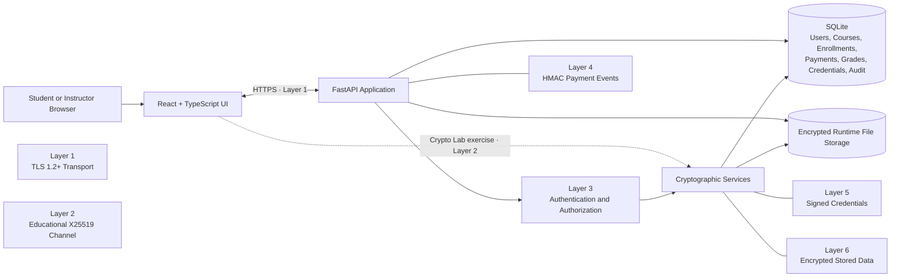

More detail on trust boundaries and key handling is in [docs/ARCHITECTURE.md](docs/ARCHITECTURE.md).

## Cryptographic workflows

### 1. User authentication

Passwords are salted and processed with PBKDF2-HMAC-SHA256. Successful login creates an HMAC-signed session cookie and a CSRF token; role and account status are checked server-side for protected routes.

```mermaid
sequenceDiagram
  actor User
  participant UI as React UI
  participant API as FastAPI
  participant DB as SQLite
  User->>UI: Submit email and password
  UI->>API: POST login over HTTPS
  API->>DB: Read account and password salt
  API->>API: PBKDF2-HMAC-SHA256; compare verifier
  API->>API: Apply failed-login lockout rules
  API-->>UI: Signed session cookie + CSRF token
  UI-->>User: Authenticated view for authorized role
```

### 2. X25519 key agreement and HKDF

The channel demonstration exchanges ephemeral public keys, derives a shared secret, expands key material with HKDF-SHA256, and uses AES-256-GCM for authenticated message encryption. This educational flow is not a custom replacement for TLS.

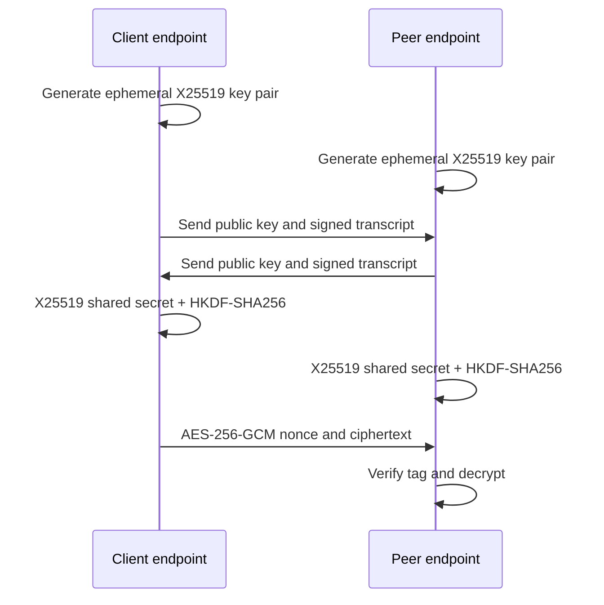

### 3. File encryption and RSA key wrapping

The server creates a random data-encryption key for an object, encrypts the bytes with AES-GCM, wraps the data key with RSA-3072-OAEP/SHA-256, and stores encrypted content and metadata. Decryption releases plaintext only after authentication succeeds.

```mermaid
sequenceDiagram
  actor Owner
  participant API as FastAPI
  participant K as Key service
  participant S as Encrypted storage
  Owner->>API: Upload file
  API->>API: Generate random AES data key and nonce
  API->>API: AES-256-GCM encrypt; calculate SHA-256 digest
  API->>K: Wrap data key with RSA-3072-OAEP/SHA-256
  API->>S: Store ciphertext and wrapped-key metadata
  API-->>Owner: Store file reference
```

### 4. Payment webhook verification

The demo provider signs the timestamp and raw request body with a shared HMAC secret. The backend verifies the signature and freshness, then checks expected order details and whether the event has already been consumed before changing enrollment state.

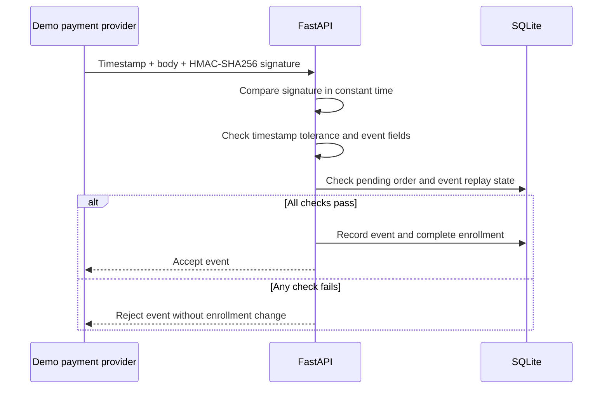

### 5. Credential signing and verification

Credential fields are canonicalized before hashing and signing. Verification recomputes the digest, checks the ECDSA signature, and validates issuer/root relationships using the local certificate material.

```mermaid
sequenceDiagram
  participant I as Instructor
  participant API as FastAPI
  participant CA as Local signing authority
  participant V as Verifier
  I->>API: Issue credential for learner
  API->>API: Canonicalize credential and calculate SHA-256
  API->>CA: Sign digest with ECDSA P-256 issuer key
  CA-->>API: Signature and certificate chain
  API-->>I: Store and display credential
  V->>API: Verify credential and chain
  API->>API: Recompute digest; verify ECDSA and X.509 links
  API-->>V: Valid or invalid result
```

### 6. Encrypted grade storage and retrieval

The application encrypts grade values before persistence and decrypts them only on an authorized read. AES-GCM authentication detects modification; server-side role checks restrict who can write or view grades.

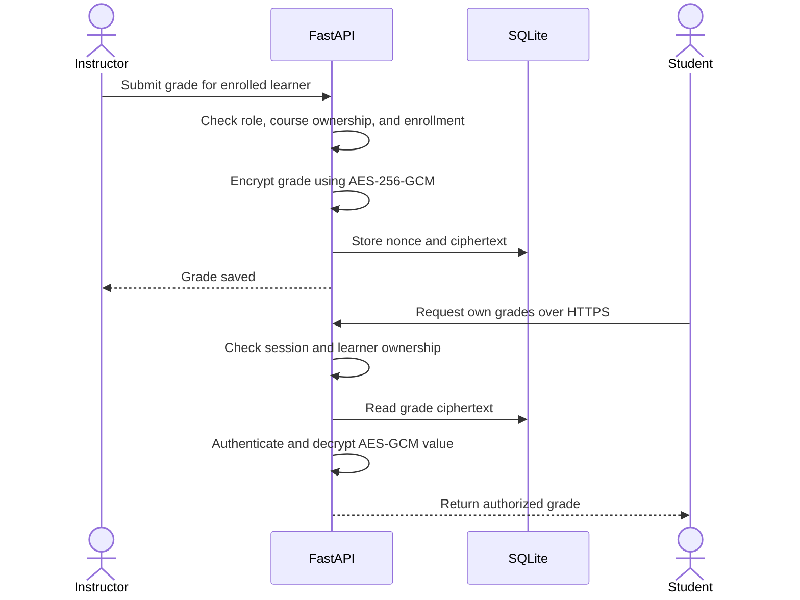

## Technology stack

| Group | Technologies | Role |
|---|---|---|
| Backend | Python, FastAPI, SQLAlchemy, SQLite | HTTP API, business rules, ORM, local persistence |
| Cryptography | Python `cryptography` package | Hashing, key derivation, authenticated encryption, key wrapping, signatures, certificates, and TLS primitives |
| Frontend | React, TypeScript, Vite, Lucide React, Recharts | Browser application, icons, development server, and instructor chart |
| Quality | Pytest, TypeScript compiler, Vite production build | Backend tests, static type checks, and frontend bundling |

The UI uses project CSS. **Tailwind CSS is not currently used.**

## Application screens

Screenshots below were captured from the running EduSecure application. They illustrate current UI state and are not product mockups.

| Screen | Preview |
|---|---|
| Landing page | 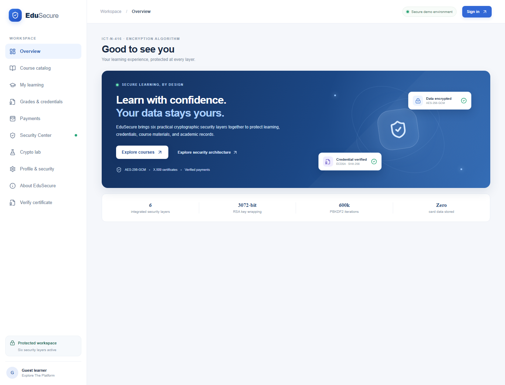 |
| Course catalog | 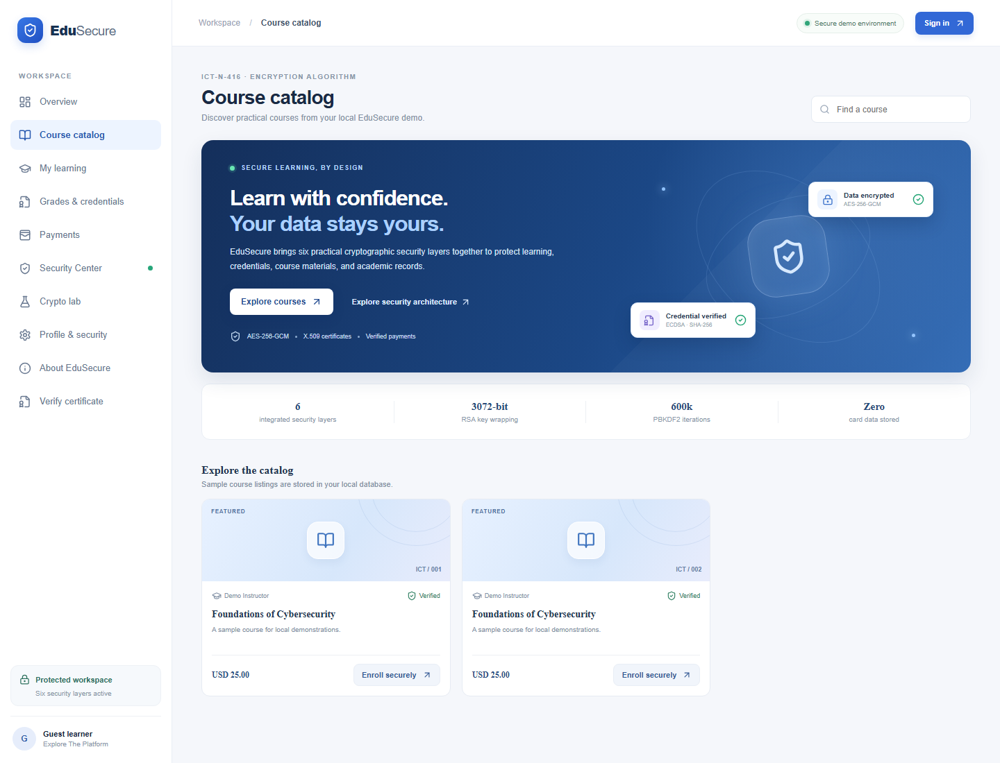 |
| Security Center | 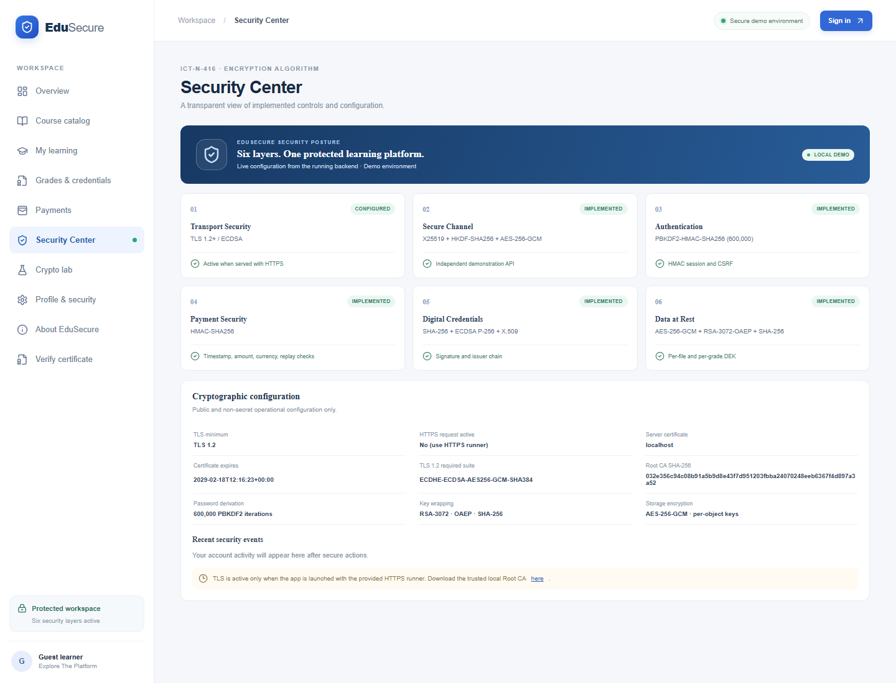 |
| Certificate verification | 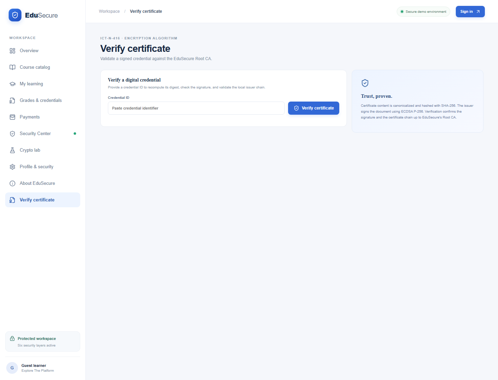 |
| Student dashboard | 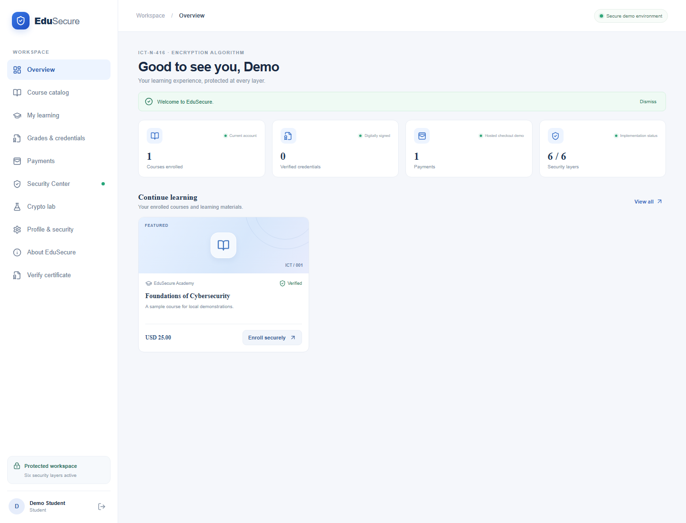 |
| Student learning | 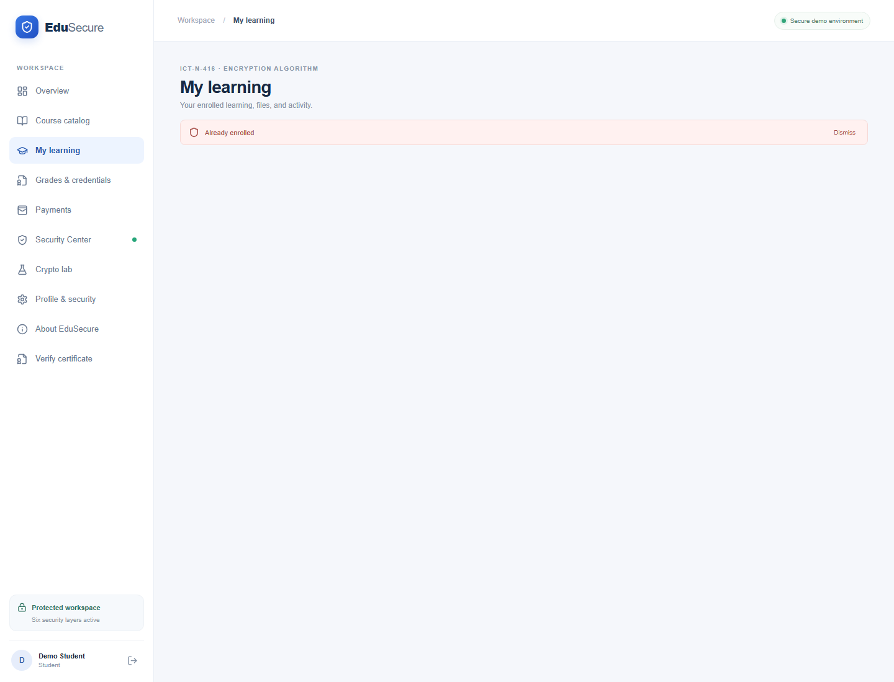 |
| Instructor dashboard | 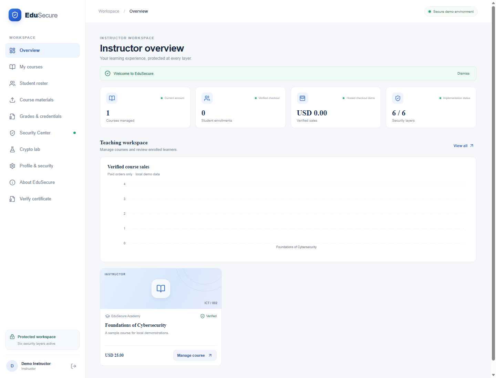 |
| Course management | 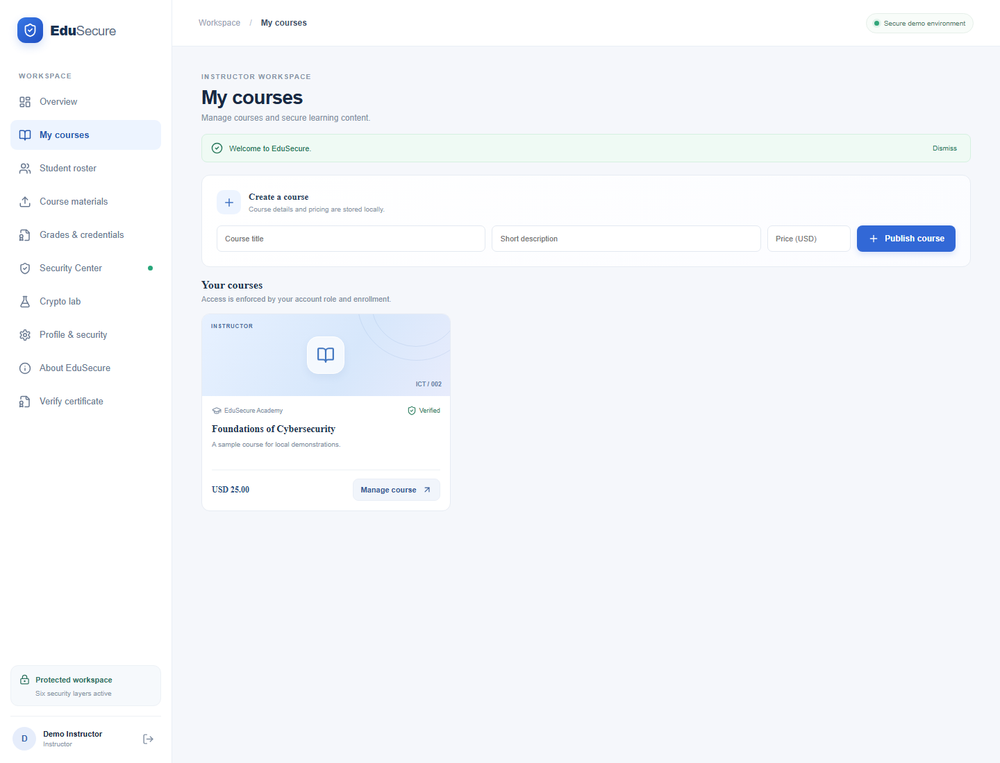 |

Students can browse courses, enroll through the simulated checkout, view learning materials, and access their grades or credentials. Instructors manage courses and rosters, record grades, and issue credentials. The Security Center surfaces security-related information; the Crypto Lab offers interactive demonstrations. These screens do not imply independent security certification.

## Security controls

| Control | Implementation notes |
|---|---|
| Password hashing and salts | PBKDF2-HMAC-SHA256 with a per-user random salt; unknown-user login performs a dummy derivation. |
| Account lockout | Repeated failed authentication attempts are temporarily throttled by the backend. |
| Session integrity | HMAC-signed session cookie with an eight-hour lifetime; secure-cookie behavior is configurable for local development. |
| CSRF | CSRF token is required for state-changing browser requests. |
| Transport headers | HTTPS server config enables TLS 1.2 minimum and the app applies HSTS and CSP response headers. |
| File and grade integrity | AES-GCM authentication tags detect ciphertext modification; SHA-256 digests are used in file/credential flows. |
| Key wrapping | RSA-3072-OAEP with SHA-256 wraps file data keys. Keys are locally stored and unsuitable for production deployment. |
| Payment event integrity | HMAC-SHA256 signature, timestamp tolerance, expected order checks, and replay prevention. |
| Credentials | ECDSA P-256 signature verification and local X.509 chain relationship checks. Certificate revocation is not implemented. |
| Authorization | Backend role checks and ownership/enrollment checks protect instructor and student operations. |

See [SECURITY.md](SECURITY.md) for responsible disclosure guidance and [docs/THREAT_MODEL.md](docs/THREAT_MODEL.md) for assets, assumptions, and threats.

## Testing and demonstrations

Run the backend suite from the repository root:

```powershell
python -m pytest backend/tests -q
```

Run the frontend type check and production build:

```powershell
Push-Location frontend
npm ci
npm run build
Pop-Location
```

The build script runs `tsc -b` before Vite bundles the UI. The backend suite includes cryptographic, application, and local TLS integration coverage. On a development machine with the required local key material initialized, `python scripts/verify_tls.py` checks the HTTPS endpoint; `python scripts/attack_demo.py` runs the scripted security demonstrations. Record current results from the latest run rather than relying on a README claim.

Latest local verification (2026-11-16): **38 backend tests passed, 0 failed, 0 skipped**; TypeScript and Vite production build passed; trusted TLS 1.2 and TLS 1.3 handshakes passed; the untrusted CA was rejected; and the attack script's four webhook cases and one encrypted-file tamper case passed. Pytest reports one Starlette deprecation warning related to its `httpx` test client integration.

### Attack demonstrations

```powershell
python scripts/attack_demo.py
```

The script exercises rejection paths for an untrusted TLS certificate, invalid or stale/replayed payment webhook events, and AES-GCM ciphertext tampering, alongside a valid simulated payment event. Expected behavior is rejection of the manipulated or untrusted inputs and no protected state change; the valid test event may update the local demo database. For a direct TLS check, start the HTTPS service in a separate terminal and run `python scripts/verify_tls.py`.

## Local setup

Python 3.10 or newer and Node.js with npm are required. These instructions create local keys, certificates, a database, and demo data. Those runtime files are intentionally excluded from Git.

### Windows PowerShell

```powershell
python -m venv .venv
.\.venv\Scripts\Activate.ps1
python -m pip install --upgrade pip
python -m pip install -r requirements.txt

Push-Location frontend
npm ci
npm run build
Pop-Location

python scripts/init_keys.py
python scripts/seed_demo.py
$env:EDUSECURE_SECURE_COOKIES = 'true'
python scripts/serve_https.py
```

Open `https://127.0.0.1:8000/` in a browser. The locally generated certificate is not publicly trusted; use the project certificate setup for local verification. For plain HTTP frontend development, `scripts/run_dev.ps1` starts the API and Vite development server with secure cookies disabled for localhost.

### Linux / macOS shell

```bash
python3 -m venv .venv
source .venv/bin/activate
python -m pip install --upgrade pip
python -m pip install -r requirements.txt

cd frontend
npm ci
npm run build
cd ..

python scripts/init_keys.py
python scripts/seed_demo.py
export EDUSECURE_SECURE_COOKIES=true
python scripts/serve_https.py
```

The demo seed script creates the local instructor and student accounts if absent and **prints newly generated passwords once**. Save them for your local session; the project does not define reusable seeded passwords. Do not paste local credentials or private keys into issues, screenshots, or commits. To start from scratch, use a separate empty local database and generated key directory; do not delete data you need.

`.env.example` documents the `EDUSECURE_*` settings, but the application does not automatically load a `.env` file. Set values in the process environment before launching the server. If session or webhook secrets are unset, the app creates random process-local values at startup; sessions and webhook signatures therefore do not persist across restarts. Keep any local `.env` file out of version control.

## Project layout

```text
backend/
  app/                 FastAPI app, database models, routes, crypto services
  tests/               Application, cryptography, and TLS integration tests
frontend/
  src/                 React/TypeScript screens and API client
scripts/               Key setup, local server, seeding, TLS check, attack demo
docs/
  assets/              Actual application screenshots for this README
documentation/         Existing project notes and academic requirements
keys/                  Generated private keys (local only; ignored by Git)
certificates/          Generated certificates (local only; ignored by Git)
storage/               Encrypted runtime objects (local only; ignored by Git)
```

The local SQLite database is created at the configured database URL (default `./edusecure.db`).

## Limitations and roadmap

- Payments are simulated; there is no payment-provider integration or card-data processing.
- Private keys and certificates are generated and stored locally. There is no production HSM or KMS integration.
- Multi-factor authentication is not implemented.
- Certificate revocation and a production trust-management service are not implemented.
- There is no production post-quantum cryptography implementation.
- The X25519 channel exchange is an educational demonstration separate from TLS.
- SQLite, local configuration, and the sample operational model target a local academic demonstration, not multi-tenant production deployment.
- The repository has no explicit license file.

Potential next steps include managed key storage, stronger deployment configuration, MFA, credential revocation, a real payment-provider sandbox, production database migrations, and a documented operational security review.

## Academic context

| Item | Context |
|---|---|
| Course | ICT-N-416 — Encryption Algorithm |
| Project | EduSecure |
| Institution | New Cairo Technological University |

EduSecure was developed as an educational exercise in applied cryptography and full-stack security engineering. Naming the academic context does not imply university endorsement, certification, or a security audit.

## License

There is currently no `LICENSE` file. All rights remain with the respective rights holder; no open-source license has been granted in this repository. Ask the project owner before adding one.
