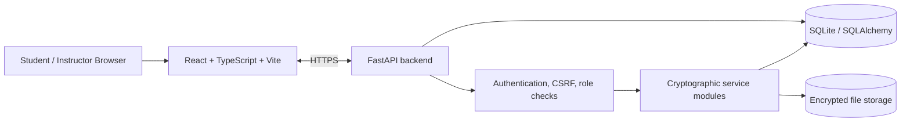

# EduSecure architecture

## Components

- `frontend/src/` contains the React/TypeScript client and its API wrapper.
- `backend/app/main.py` defines the FastAPI application and HTTP routes.
- `backend/app/models.py` defines SQLAlchemy entities for users, courses, enrollments, payments, materials, grades, credentials, and audit events.
- `backend/app/cryptography/` contains cryptographic primitives, the educational channel flow, and certificate/credential authority helpers.
- `backend/app/database.py` configures SQLAlchemy; the default local database is `edusecure.db`.
- `scripts/` contains local key initialization, demo seeding, HTTPS serving, TLS verification, and attack demonstrations.

## Request and trust boundaries

The browser is an untrusted client. The API authenticates requests and enforces role and ownership rules before accessing protected records. The frontend does not make authorization decisions. Local TLS protects traffic in transit when the client trusts the generated server certificate. The Crypto Lab's X25519 exchange is a separate educational feature and is not part of or a replacement for browser TLS.

SQLite and the filesystem are local trust boundaries. Files and grade values are encrypted before persistence with AES-GCM. File data-encryption keys are wrapped with RSA-OAEP. Key and certificate files are generated under `keys/` and `certificates/`; they are local runtime assets, ignored by Git, and must not be reused as production keys.

## Cryptographic operations

| Use | Operation |
|---|---|
| Password verification | PBKDF2-HMAC-SHA256 with per-user salt |
| Browser session | HMAC-signed session cookie plus CSRF token |
| Educational channel | X25519, HKDF-SHA256, AES-256-GCM |
| Payment webhook | HMAC-SHA256 over timestamp and raw body; freshness and replay checks |
| Credentials | Canonicalized payload, SHA-256, ECDSA P-256, local X.509 validation |
| Files and grades | AES-256-GCM; RSA-3072-OAEP/SHA-256 key wrapping for file objects; SHA-256 content digest |
| Transport | Local HTTPS configured for TLS 1.2 minimum and ECDSA server certificate |

## Local initialization

`python scripts/init_keys.py` generates local keys/certificates, and `python scripts/seed_demo.py` creates demo records with one-time random passwords if the accounts are absent. Runtime storage and the SQLite database are generated locally and excluded from source control. The application is intended for local educational use, not deployment with real student records.
