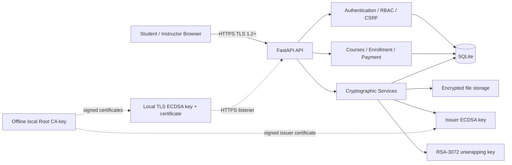

# EduSecure architecture

The frontend is a React/TypeScript single-page application. It uses same-origin `/api` requests in production and a Vite development proxy while working locally. API routes call cryptographic wrappers in `backend/app/cryptography`; route handlers enforce authorization and call data services. SQLAlchemy persists application records. Filesystem storage contains AES-GCM ciphertext, nonces are stored in the database, DEKs are RSA-OAEP-wrapped, and digests support post-decryption verification.

The X25519/HKDF record channel is a separate demonstration. It authenticates ephemeral key material with the issuer's ECDSA signature and verifies the issuer chain. It is not wired as an alternate web transport.
